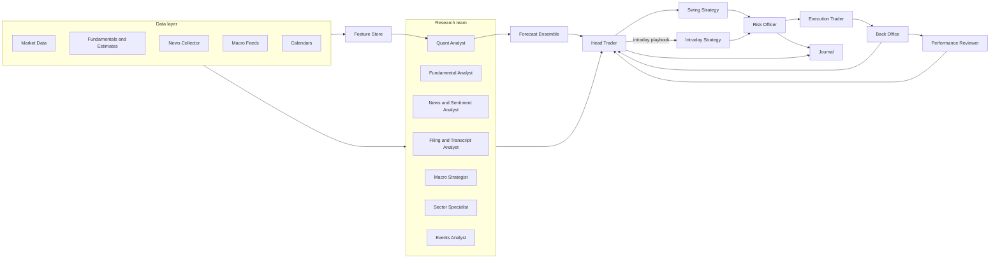

# Architecture: the autonomous trading desk

Status: draft for review, 2026-11-01. No code exists yet. The decisions this document relies on are in [00-decisions.md](00-decisions.md).

## 1. What we are building

One autonomous **head trader** agent runs a team of specialist agents. The team researches, the head trader forms theses and decides, an independent **risk officer** approves, modifies or vetoes every order, and an **execution trader** places it with the broker. The desk runs two books on US equities:

- **Swing book**: positions held days to weeks. Decided once a day after the close, confirmed pre-market, re-evaluated during the day when relevant evidence arrives.
- **Intraday book**: positions held minutes to hours, flat before the close. Deterministic setups chosen each morning by the head trader, executed bar by bar, supervised by live news and risk.

It starts at autonomy level 1 (autonomous paper trading) and is built so that moving to live trading is a configuration change plus a human decision, never a rewrite.

Out of scope for v1: sub-second trading, options or futures trading, live money before paper results exist.

## 2. Design principles

1. **Event-driven.** Agents never call each other. Each agent consumes events from topics and publishes events to topics. Only the head trader knows the workflow, so agents can be added, replaced or run in parallel without touching the others.
2. **Judgment from LLMs, arithmetic from models, safety from rules.** LLM agents read unstructured material and synthesize evidence. Quantitative models produce forecasts we can backtest. Risk rules are deterministic, sit above both, and cannot be overridden by any reasoning agent.
3. **Point-in-time correctness.** Every event carries `occurred_at` (when it happened in the world) and `ingested_at` (when we learned of it). Backtests may only use what was knowable at the simulated clock. Fundamentals are used as first reported, never as later restated.
4. **One code path.** Backtest, paper and live run the same agents on the same bus. Only the clock source and the broker adapter differ.
5. **Every decision is explainable.** An order traces back to a thesis, the analyst reports and forecasts it relied on, and the raw events behind them. The journal stores this chain.
6. **Autonomy is a dial.** Levels 0 to 3 over identical code (section 9).
7. **Fail safe, never fail open.** Missing or stale data lowers confidence or skips the trade. An unhandled failure halts new orders and alerts a human; it never guesses.

## 3. The desk



Every edge in the diagram is an event on the bus, not a function call.

| Role | Kind | Consumes | Produces |
|---|---|---|---|
| **Head Trader** (orchestrator) | State machine plus Claude Opus 5.5 | research.report, thesis.challenge, forecast.ensemble, portfolio.*, high-impact news.article.scored, macro.release, calendar.* | cycle.*, research.request, research.deepdive.request, thesis.draft, thesis.*, order.intent, playbook.intraday |
| **Skeptic** | Claude Opus 5.5 | thesis.draft and the research.report set behind it | thesis.challenge |
| **Quant Analyst** | Models (LightGBM, time series) | features.vector.ready, market.bar.* | forecast.generated, research.report |
| **Fundamental Analyst** | Deterministic scoring plus Opus synthesis | data.fundamentals.*, data.estimates.*, data.ownership.*, filing.analyzed | research.report |
| **News and Sentiment Analyst** | Claude Haiku 5.5 bulk, Opus escalation | news.article.raw, social.snapshot | news.article.scored, news.state, research.report |
| **Filing and Transcript Analyst** | Claude Opus 5.5 | filing.new, transcript.new | filing.analyzed, research.report |
| **Macro Strategist** | Deterministic indicators plus Opus narrative | macro.release, macro.indicator.updated, index and volatility bars | macro.regime.updated, research.report |
| **Sector Specialist** | Deterministic plus Opus | sector ETF bars, peers' events and reports | research.report |
| **Events Analyst** | Deterministic | calendar feeds, filings | calendar.*.upcoming, event.alert |
| **Feature Store** | Deterministic | every data event | features.vector.ready, features.intraday.ready |
| **Forecast Ensemble** | Model stacking | forecast.generated | forecast.ensemble |
| **Swing Strategy** | Deterministic rules over forecasts and theses | forecast.ensemble, thesis.*, macro.regime.updated | signal.proposed, order.intent |
| **Intraday Strategy** | Deterministic setups | market.bar.1m, features.intraday.ready, news.state, playbook.intraday | signal.proposed, order.intent |
| **Risk Officer** | Deterministic, no LLM | order.intent, portfolio.*, market data | risk.approved, risk.modified, risk.rejected, risk.kill_switch |
| **Execution Trader** | Deterministic, broker adapter | risk.approved | order.submitted, order.partial, order.filled, order.canceled, order.rejected |
| **Back Office** | Deterministic | order.filled, broker account state | portfolio.position.updated, portfolio.pnl.updated, portfolio.reconciled |
| **Performance Reviewer** | Statistics plus Opus post-mortem | closed theses, reports, forecasts, fills | review.trade.postmortem, review.analyst.score |
| **Journal** | Deterministic | everything | audit trail, daily brief |
| **Desk Console** | Claude Opus 5.5 with read-only tools | your messages, journal, theses, reports, positions | answers in chat, approval requests at level 2, console.* events in the journal |
| **Monitor** | Deterministic | system.*, latencies, costs | system.alert |

**Why the risk officer is a separate agent.** The head trader is an LLM that will sometimes be confidently wrong. The risk officer is a few hundred lines of deterministic code with hard limits. No event the head trader can emit bypasses it. Real desks separate these roles for the same reason.

### 3.1 Anatomy of an LLM agent

Every reasoning agent on the desk (the head trader, the skeptic, the seven analysts, and the reviewer's narrative) is built from the same six parts. Expertise comes from these parts, not from different model weights.

| Part | What it is | Where it lives |
|---|---|---|
| Role prompt | What it looks at, how it reasons, its domain glossary, what a good call looks like, what it must never claim | `prompts/<agent>/v<N>.md`, versioned |
| Own evidence | A pack built deterministically from its data domain only | `agents/<agent>/pack.py` |
| Own tools | Read-only, clock-aware queries over our database for deep dives; never the open web | `agents/<agent>/tools.py` |
| Output schema | A pydantic model the head trader can compare across agents | `core/schemas.py` |
| Memory | Its past reports, their outcomes, and the lessons distilled from them | the memory subsystem, one bank per agent (technical design, section 7) |
| Scorecard | Credibility by horizon and regime, computed by the reviewer | `analyst_scores`, `credibility_weights` |

Two working modes:

- **Standard**: one call on a pre-built evidence pack. Cheap and reproducible, the default for every symbol every day.
- **Deep dive**: an agent loop with at most five tool calls, triggered by the head trader for names where conviction is high or the reports disagree. Tools are read-only and take their time from the Clock, so a deep dive replays exactly.

Analysts work independently and in parallel, then the head trader synthesizes. They do not read each other's reports: independence prevents groupthink and keeps the token bill flat.

**The skeptic.** Before any order intent leaves the head trader, the skeptic reads the draft thesis and the reports behind it and writes the strongest case against it: evidence that contradicts the stance, risks the reports underweighted, and what the thesis assumes without saying. The head trader must answer each point in a structured reply before the thesis becomes an order intent. One extra call per decision, and the single most effective check on an overconfident reasoning agent.

**The desk console.** The human interface. A chat, command line first and Telegram or Slack later, where every message goes to the head agent. It answers from the database through read-only, clock-aware tools, cites the reports and events behind the answer, and logs the exchange in the journal. At autonomy level 2 the same channel carries order approvals. It never places an order itself.

**Which agents may use an LLM.** The head trader, the skeptic, the seven analysts, and the reviewer's narrative. The risk officer, execution trader, back office, feature store, forecast models, replayer, journal and monitor never call one. That boundary is a design rule, not a cost choice.

## 4. Two books, one desk

| | Swing book | Intraday book |
|---|---|---|
| Holding period | 2 to 30 trading days | Minutes to hours, flat by 15:55 ET |
| Decision cadence | Daily cycle plus event-triggered re-evaluation | Every 1-minute bar, inside a pre-market playbook |
| Who decides | Head trader (LLM) forms a thesis; Swing Strategy turns it into orders | Head trader writes the playbook pre-market; Intraday Strategy executes deterministically |
| Inputs that matter most | Forecast ensemble, fundamentals, estimate revisions, news and sentiment, macro regime, sector, events calendar | Opening range, VWAP, relative volume, gaps, order flow, news shocks, market internals, key levels, scheduled macro releases |
| LLM in the loop | Yes, on every decision | Only pre-market and on news shocks; never between a bar and an order |
| Universe | Static core of about 30 names | Dynamic daily watchlist of 10 to 20 names |
| Capital | Risk budget set weekly by the head trader, enforced by the risk officer | Separate, smaller risk budget; a daily loss limit halts the book |

The two books share the data layer, feature store, news pipeline, risk officer, execution, back office, reviewer and journal. The head trader allocates a risk budget to each book weekly, based on regime and recent book performance; the risk officer enforces it.

**Latency budget.** Intraday: bar close to order intent in under one second on the deterministic path. News interpretation by Claude Haiku 5.5 takes a few seconds and feeds a per-symbol `news.state` that the strategies read on the next bar; it is never between a bar and an order. Swing: minutes are fine.

## 5. Event model

### 5.1 Envelope

Every event on the bus has the same envelope; the payload is typed per event type with pydantic.

| Field | Meaning |
|---|---|
| `event_id` | ULID, globally unique, time-sortable |
| `type` | Topic name, for example `news.article.scored` |
| `schema_version` | Integer, bumped on breaking payload changes |
| `occurred_at` | When it happened in the world (UTC). The only timestamp a backtest may use |
| `ingested_at` | When the desk learned of it (UTC) |
| `symbol` | Ticker, or null for market-wide events |
| `book` | `swing`, `intraday`, or null |
| `correlation_id` | The cycle or playbook this belongs to |
| `causation_id` | The `event_id` that directly caused this event |
| `source` | Producing agent and its version |
| `payload` | Typed body |

`correlation_id` lets the journal reconstruct one complete decision. `causation_id` gives the exact causal chain.

### 5.2 Topics

| Domain | Topics |
|---|---|
| Market data | `market.bar.1m`, `market.bar.1d`, `market.quote`, `market.trade` (optional), `market.halt`, `market.session` (open, close, early close) |
| Reference data | `data.fundamentals.updated`, `data.estimates.updated`, `data.ownership.updated`, `data.short_interest.updated`, `data.options.snapshot` |
| Calendar | `calendar.earnings.upcoming`, `calendar.economic.upcoming`, `calendar.corporate_action`, `event.alert` |
| Text | `news.article.raw`, `news.article.scored`, `news.state`, `filing.new`, `filing.analyzed`, `transcript.new`, `social.snapshot` |
| Watcher | `watcher.alert` (abnormal move, volume spike, halt, level break, stale data) |
| Macro | `macro.release`, `macro.indicator.updated`, `macro.regime.updated` |
| Features | `features.vector.ready`, `features.intraday.ready` |
| Research | `research.request`, `research.deepdive.request`, `research.report`, `forecast.generated`, `forecast.ensemble` |
| Decision | `playbook.intraday`, `thesis.draft`, `thesis.challenge`, `thesis.created`, `thesis.updated`, `thesis.invalidated`, `signal.proposed`, `order.intent` |
| Risk | `risk.approved`, `risk.modified`, `risk.rejected`, `risk.limit.breached`, `risk.kill_switch` |
| Execution | `order.submitted`, `order.partial`, `order.filled`, `order.canceled`, `order.rejected` |
| Portfolio | `portfolio.position.updated`, `portfolio.pnl.updated`, `portfolio.reconciled` |
| Workflow | `cycle.started`, `cycle.stage.completed`, `cycle.completed`, `cycle.failed` |
| Learning | `review.trade.postmortem`, `review.analyst.score`, `model.promoted` |
| System | `system.health`, `system.alert` |

### 5.3 Key payloads

**ResearchReport.** Every analyst produces the same shape so the head trader can compare them.
- `analyst`, `symbol` (or market-wide), `horizon` (`intraday`, `days`, `weeks`)
- `stance`: bullish, bearish or neutral; `conviction`: 0 to 1
- `summary`: three sentences maximum
- `evidence`: list of `event_id`s with one line each on why it matters
- `risks`: what could make this wrong
- `invalidation`: observable conditions that would flip the stance
- `numbers`: optional structured metrics (quant and fundamental analysts)

**Forecast.** From each model, and from the ensemble.
- `model_id`, `trained_through`, `symbol`, `horizon`
- `expected_return`, `quantiles` (5, 25, 50, 75, 95), `p_up`, `p_move_beyond_threshold`
- `top_features`: attribution for the top five drivers
- `confidence`: the model's own calibration estimate for the current regime

**Thesis.** Section 7.

**OrderIntent.** `symbol`, `book`, `side`, `target_position` (shares or notional), `order_type`, `limit_price`, `time_in_force`, `thesis_id`, `urgency`, `rationale_event_ids`.

**RiskDecision.** `intent_id`, `decision` (approved, modified, rejected), `approved_quantity`, `rules_evaluated` (each with pass or fail and the numbers), `reason`.

## 6. The head trader's day

All times US Eastern. The scheduler uses the exchange calendar, so holidays and early closes are handled.

| Time | Stage | What happens |
|---|---|---|
| 16:05 | `cycle.started` (swing, for the next session) | Head trader requests the end-of-day data refresh for the core universe |
| 16:10 to 16:40 | Collecting, featurizing | Daily bars, fundamentals and estimate updates land; Feature Store emits `features.vector.ready` |
| 16:40 to 17:30 | Researching | Each analyst publishes a `research.report` per symbol or market-wide. Quant models publish forecasts; the ensemble combines them |
| 17:30 to 18:30 | Deciding | Head trader reviews every open thesis against new evidence and drafts new theses. The skeptic writes the strongest case against each draft; the head trader answers point by point, then emits `order.intent`s for the next open. Writes the daily brief |
| 18:30 | Risk review | Risk officer evaluates intents against limits; approved orders are queued, not sent |
| Overnight | Bulk work | News scoring via the Batch API, transcript analysis, model retraining when scheduled |
| 07:30 | Pre-market check | Overnight news, futures and the 08:30 macro releases are flagged. Head trader confirms, resizes or cancels queued orders |
| 08:00 to 09:15 | Intraday playbook | Head trader selects the intraday watchlist and the allowed setups per name, sets the risk budget, lists no-trade windows around scheduled releases |
| 09:30 to 15:55 | Session | Execution works queued swing orders. Intraday Strategy runs bar by bar. News shocks update `news.state`. Any event relevant to an open thesis triggers re-evaluation |
| 15:55 | Flatten | Intraday book closes all positions |
| 16:00 | Back office | Reconcile positions and cash against the broker. Reviewer grades closed trades and today's forecasts |

### 6.1 Swing cycle state machine

`PLANNED -> COLLECTING -> RESEARCHING -> FORECASTING -> DECIDING -> RISK_REVIEW -> QUEUED -> EXECUTING -> MONITORING -> CLOSED`, with `FAILED` reachable from any state.

Each stage has a timeout and a partial-data policy:

| Stage | Timeout | If incomplete |
|---|---|---|
| Collecting | 30 min | Proceed if daily bars for all core names are present; otherwise fail the cycle and alert |
| Researching | 50 min | Proceed with the reports received; mark missing analysts; head trader lowers conviction accordingly |
| Forecasting | 15 min | Proceed with available models; ensemble reweights |
| Deciding | 60 min | Fail the cycle; keep existing positions; no new orders |
| Risk review | 5 min | Fail the cycle; nothing is sent |

### 6.2 Event-triggered re-evaluation

Outside the schedule, these events wake the head trader for the affected symbols:

- `news.article.scored` with impact above threshold on a held or watched name
- `macro.release` with a surprise above one standard deviation
- `thesis.invalidated` (a stated invalidation condition was observed by the Swing Strategy)
- `risk.limit.breached`
- `market.halt` on a held name

Re-evaluation is a mini-cycle: gather the reports that are still fresh, request updates from the analysts whose domain changed, decide, risk review, execute.

### 6.3 Intraday loop

For each `market.bar.1m` on a watchlist name: the Feature Store computes intraday features, the Intraday Strategy evaluates the setups the playbook allows for that name, emits `signal.proposed` and `order.intent`, the risk officer approves within the book's budget, execution sends. The loop contains no LLM call. The head trader's influence is the playbook and the `news.state` maintained by the sentiment analyst.

## 7. Thesis: the trader's memory

Every swing position exists because of a thesis. The thesis is a stored object, updated as evidence arrives, and closed with a post-mortem.

| Field | Content |
|---|---|
| `thesis_id`, `symbol`, `book`, `direction` | Identity |
| `created_at`, `status` | `active`, `invalidated`, `target_hit`, `expired`, `closed_by_risk` |
| `narrative` | Why we are in this trade, in plain language |
| `evidence` | Analyst reports and forecasts relied on, by event id |
| `expected_return`, `horizon_days`, `target_price` | What we expect |
| `invalidation` | Observable conditions: price-based (stop), evidence-based (guidance cut, sentiment flip, sector breakdown), time-based (maximum holding period) |
| `size_rationale` | Why this size |
| `updates` | Each re-evaluation: what changed, decision taken |

The Swing Strategy monitors price- and time-based invalidation deterministically every bar. Evidence-based invalidation is judged by the head trader on re-evaluation. This is what makes exits intelligent: the desk sells when the reason it bought stops being true, when the target is reached, or when risk rules demand it.

## 8. Risk officer

Deterministic, versioned, fully logged. Each rule returns pass or fail with the numbers. First set:

**Per order.** Notional and share bounds (fat-finger check); price within a band of the last trade; order size at most a fixed share of the name's 20-day average volume; no orders during halts or auction-only periods; rate limit on orders per minute.

**Per position.** Maximum position as a share of equity; maximum loss per trade (stop distance times size) as a share of equity; volatility-scaled sizing to a target risk contribution.

**Per book.** Gross and net exposure caps; a daily loss limit that halts the book; maximum number of open positions; the intraday book must be flat by 15:55.

**Portfolio.** Gross and net exposure caps; sector concentration cap; correlation cap (do not add exposure to an already crowded factor); drawdown-from-peak thresholds that first de-risk, then halt; pattern-day-trader rule awareness; margin usage cap.

**Kill switch.** Manual (a command) and automatic (daily loss, drawdown, data staleness, broker disconnect, repeated rejected orders). When engaged, only closing orders are allowed.

The risk officer never consults an LLM.

## 9. Autonomy ladder

| Level | Name | Orders | Human |
|---|---|---|---|
| 0 | Research desk | None. Daily brief with recommended trades | Trades manually |
| 1 | Paper, autonomous | Sent to the paper broker automatically | Reviews the brief and the journal |
| 2 | Live, approval gate | Each approved intent waits for a human yes or no, with a timeout that defaults to no | Approves each order |
| 3 | Live, autonomous within limits | Sent automatically inside the risk officer's limits | Can halt at any time; receives alerts |

One configuration value. Live levels also require a separate live API key and an explicit startup confirmation.

## 10. Learning loop

- **Trade post-mortems.** Each closed thesis is graded: realized versus expected return, whether the exit was target, invalidation, time or risk, and what the evidence looked like in hindsight. Opus writes a short narrative; the statistics are deterministic.
- **Analyst credibility.** The reviewer scores each analyst's stance and conviction against realized outcomes at the stated horizon (Brier score, hit rate, information coefficient), by regime. The head trader's prompt includes the current credibility weights, so it trusts accurate analysts more.
- **Forecast calibration.** Predicted quantiles are checked against realized returns. Miscalibration is reported and used to shrink conviction.
- **Model retraining.** Weekly walk-forward retraining; a challenger replaces the incumbent only if it wins out of sample on the metrics that matter (Sharpe after costs, calibration, turnover).
- **Prompt and playbook review.** Monthly human review of head-trader decisions versus outcomes; prompt changes are versioned and compared on replay.

## 11. LLM policy

| Use | Model | Settings |
|---|---|---|
| Bulk news relevance and sentiment scoring, deduplication | `claude-haiku-5-5` | Structured output, low effort, Batch API overnight, prompt caching on the stable instructions |
| Analyst report synthesis, filing and transcript analysis, head-trader decisions, post-mortem narratives | `claude-opus-5-5` | Adaptive thinking, effort high for decisions, structured output |
| Escalation of ambiguous or high-impact news | `claude-opus-5-5` | Triggered when Haiku's confidence is low or the estimated impact is high |
| Skeptic challenge of every draft thesis | `claude-opus-5-5` | Effort high, structured output, the same cached layers as the head trader |
| Deep dive by an analyst | `claude-opus-5-5` | Agent loop with at most five read-only, clock-aware tool calls, effort medium |

Rules:
- Every LLM output is a pydantic-validated structure (via `client.messages.parse`) with a confidence and the `event_id`s it relied on. Free text is allowed only inside a `summary` or `narrative` field.
- An LLM never places an order. It emits `order.intent`, which must pass the deterministic risk officer.
- Stable instructions (role, factor glossary, output schema) go first in the prompt with a cache breakpoint; volatile data comes after.
- `stop_reason` is checked before reading any response; refusals use the server-side default fallback so a classifier decline does not stall the desk.
- Every call is logged with prompt hash, model, tokens and cost. Replays reuse cached outputs by prompt hash for reproducibility and cost control.
- Prompts are versioned files in the repository, never inline strings.
- Only the head trader, the skeptic, the analysts and the reviewer's narrative call an LLM. The risk officer, execution, back office, feature store, models, replayer, journal and monitor never do.

## 12. Data layer

Decision of 2026-11-02: start every source on its free tier and upgrade only when a defined trigger is hit. There is no budget ceiling once a trigger fires. Alpaca's paper account only simulates order fills; historical prices and news come from Alpaca's separate market data API and from the sources below, and they are identical for paper and live accounts.

### 12.1 Free-first sources and their upgrade triggers

Limits are as published or reported in late 2026; confirm at signup.

| Need | Free source we start with | Known limits | Upgrade trigger | Paid upgrade |
|---|---|---|---|---|
| Historical daily and minute bars, trades, quotes | Alpaca Market Data, Basic plan, `feed=sip` | Full consolidated history since 2016 for everything older than 15 minutes; about 200 calls per minute | None for backtests. Live intraday paper trading in phase 5 needs real-time consolidated data | Alpaca Algo Trader Plus, about $99 per month: real-time SIP, OPRA options, 10,000 calls per minute |
| Backup price history | yfinance (Yahoo, unofficial), Stooq for long daily history | Unofficial, can break without notice; short intraday history | Only used as a cross-check for data quality | None |
| Real-time quotes during the session | Alpaca Basic WebSocket on the IEX feed, plus 15-minute delayed SIP | IEX is a small share of volume; 30 symbols per connection | Phase 5 live paper intraday | Algo Trader Plus |
| Company news | Alpaca News API (Benzinga content, history back to 2015), SEC EDGAR 8-K feed, company and wire RSS feeds, GDELT | Rate limits on free keys; RSS has no history | Latency or coverage gaps measured in phase 3 | Benzinga direct, Massive news, or a paid news API |
| Filings | SEC EDGAR: submissions API, full-text search, XBRL company facts, Financial Statement Data Sets | Fair-use limit of about 10 requests per second; as-filed data with exact timestamps, which is what we want | None expected | None |
| Earnings call transcripts | Company investor-relations pages and EDGAR exhibits where published | Patchy coverage, manual parsing | The phase 3 transcript analyst needs reliable coverage | Financial Modeling Prep paid, Finnhub paid, or Quartr |
| Fundamentals, point in time | EDGAR XBRL company facts aligned by filing date | Raw statement data; we compute ratios ourselves | None for v1 | Intrinio or FMP paid for pre-computed as-reported history |
| Analyst estimates and revisions | Finnhub free (consensus snapshots), FMP free (about 250 requests per day) | Snapshots only, no point-in-time revision history; non-commercial terms | Revision features need true history, phase 3 | FMP paid, Zacks, Intrinio, or LSEG |
| Earnings and economic calendar | Finnhub free, FMP free, Nasdaq earnings calendar | Daily call budgets | Reliability problems during earnings season | Trading Economics or FMP paid |
| Macro series | FRED API, BLS, BEA, Treasury, Atlanta Fed GDPNow, CME FedWatch page | Generous free limits | None expected | None |
| Market regime inputs | VIX and index history from FRED and Alpaca; CBOE published indices; sector ETF bars from Alpaca | VIX term structure and SKEW need CBOE pages | Options analytics in phase 4 or later | Massive options plan or CBOE DataShop |
| Options chain data | Alpaca Basic indicative options data; CBOE delayed quotes | Current snapshots only, no history | Gamma and implied-volatility factors need history | Massive options, ORATS, or SpotGamma |
| Short interest, insiders, institutions | FINRA short interest (twice monthly), EDGAR Form 4 and 13F | Published with a lag; align to release dates | Daily short-interest estimates wanted | Ortex or S3 Partners |
| Positioning and sentiment surveys | CFTC Commitments of Traders, FINRA margin debt, ICI flows, AAII, NAAIM | Weekly or monthly | None expected | Vanda or similar for retail flow |
| Social | Reddit API free tier, StockTwits API free tier, Google Trends through pytrends | Rate limits and terms of use; X API excluded on cost | Only if phase 3 shows the features carry signal | Paid social aggregators |
| Exchange calendar | `exchange_calendars` library | None | None | None |

### 12.2 Why this covers the whole build through phase 4

Backtests only ever need data older than 15 minutes, so Alpaca's free tier provides the full consolidated minute-bar history for both books. EDGAR gives as-filed fundamentals with exact timestamps, which is better for point-in-time correctness than most pre-computed feeds. FRED covers macro. The first paid upgrade is Algo Trader Plus when live paper trading of the intraday book starts, because the free real-time feed only shows IEX volume. The second is likely analyst-estimate history for the revision features.

### 12.3 Collector rules

Each source gets a collector agent with: a schedule or a stream, retry with backoff that respects the source's rate limit, schema validation, deduplication, `occurred_at` extraction from the source's own timestamps, and a staleness alarm. Free-tier call budgets are tracked as metrics, so every upgrade decision is made on numbers.

## 13. Storage

| Store | Technology | Holds |
|---|---|---|
| Bus | Redis Streams | Live events with consumer groups and replay; a bounded window |
| System of record | PostgreSQL with TimescaleDB | Every event (append-only), bars, features, theses, orders, fills, positions, risk decisions, LLM calls |
| Research lake | Parquet files queried with DuckDB | Nightly exports of features and outcomes for model training and backtests |
| Documents | Local disk, later S3 | Raw article and filing text, transcripts |
| Models | MLflow | Model versions, metrics, promotion history |
| Search | pgvector in PostgreSQL | Embeddings for news retrieval and deduplication |
| Memory | PostgreSQL, same cluster, pgvector and tsvector | World and experience memories, versioned observations with evidence, knowledge pages, one bank per learning agent; design in technical design section 7 |

## 14. Backtesting by replay

The backtester is not a separate engine. It is a **Replayer** agent that reads historical events ordered by `occurred_at` and publishes them onto the bus under a simulated clock, plus a **Simulated Broker** adapter that fills orders using a slippage and cost model (spread, participation rate, commissions, borrow fees). Every other agent runs unchanged.

Guarantees we enforce:
- Agents can only read state as of the simulated clock (the Feature Store and data agents are clock-aware).
- Fundamentals and estimates use first-reported values and their publication timestamps.
- Corporate actions are applied as of their effective dates; survivorship bias is avoided by keeping delisted names in the history.
- LLM calls during replay use the output cache keyed by prompt hash; cache misses are billed and logged.
- Costs, slippage and borrow fees are always on. Results are reported after costs or not at all.

Walk-forward evaluation: train on a window, test on the following period, roll forward. Report Sharpe after costs, maximum drawdown, hit rate, calibration, turnover, and exposure by factor.

## 15. Operations, observability, security

- **Metrics**: Prometheus and Grafana for agent latency, bus lag, data staleness, LLM cost per day, positions, profit and loss, risk utilization.
- **Alerts**: kill-switch engagement, failed cycles, stale feeds, broker disconnects, abnormal order rates, LLM spend spikes. The channel is open question O2.
- **Daily brief**: the journal renders the plan, the day's decisions with rationale, performance, and open theses.
- **Secrets**: `.env` locally, a secret manager in the cloud. Paper and live keys are separate; live requires an explicit flag.
- **Deployment**: Docker Compose with Redis, PostgreSQL, and each agent as a process. A single asyncio process can run all agents in phase 1; splitting is a deployment change, not a code change.
- **Time**: all timestamps UTC in storage; Eastern only at the edges.

## 16. Technology stack

| Concern | Choice |
|---|---|
| Language | Python 3.12, asyncio |
| Schemas | pydantic v2 for every event payload and LLM output |
| Bus | Redis Streams (in-memory implementation for tests) |
| Storage | PostgreSQL plus TimescaleDB, Parquet plus DuckDB, pgvector |
| Data wrangling | polars and pandas |
| Models | LightGBM for tabular forecasts, statsmodels and arch for volatility, PyTorch later if justified |
| LLM | Anthropic Python SDK: `claude-opus-5-5`, `claude-haiku-5-5` |
| Scheduling | APScheduler with `exchange_calendars` |
| Broker | alpaca-py |
| Experiment tracking | MLflow |
| Observability | OpenTelemetry, Prometheus, Grafana |
| Testing | pytest, hypothesis for schema fuzzing, replay fixtures |

## 17. Proposed repository layout

```
bot-trading/
  docs/                      design documents (this folder)
  src/desk/
    core/                    event envelope, bus interfaces, clock, config, autonomy level
    bus/                     redis streams and in-memory implementations
    agents/
      head_trader/           orchestrator, state machines, prompts, thesis logic
      research/              quant, fundamental, news_sentiment, filing, macro, sector, events
      features/              feature store, technical and intraday features
      forecast/              models, ensemble, training, calibration
      strategy/              swing and intraday strategies
      risk/                  risk officer rules
      execution/             broker adapters: alpaca paper, alpaca live, simulated
      portfolio/             back office, reconciliation
      review/                performance reviewer, analyst scoring
      journal/               audit trail, daily brief
    data/                    collectors per vendor
    replay/                  replayer and simulated broker
    llm/                     anthropic client wrapper, prompt registry, output cache, cost log
  prompts/                   versioned prompt files
  configs/                   universe, limits, schedules, autonomy level
  research/                  notebooks and experiment scripts
  tests/
  docker-compose.yml
  pyproject.toml
```

As built (2026-11-04): the bot lives in `src/desk` (core, bus, storage, data, agents), the interface backend in `services/api/src/desk_api`, the interface in `web/`, deployment in `deploy/`. The research, forecast and replay packages above arrive with phases 2 to 4.

## 18. Project risks and how the design answers them

| Risk | Mitigation |
|---|---|
| Lookahead bias makes backtests lie | Dual timestamps, clock-aware agents, first-reported fundamentals, replay through the same code |
| Overfitting to history | Walk-forward only, challenger-versus-incumbent promotion, few parameters, costs always on |
| LLM hallucination or overconfidence | Structured outputs with cited evidence, credibility weights, deterministic risk officer above every decision |
| Weak and decaying signals | Ensemble across independent factor families, regime awareness, honest post-cost reporting; the desk is allowed to do nothing |
| Data quality and gaps | Per-collector validation, staleness alarms, fail-safe policies |
| Cost of data and LLM calls | Haiku for bulk, Batch API overnight, prompt caching, output cache on replay, daily spend alerts |
| Broker or feed outage during the session | Kill switch on disconnect, closing-only mode, reconciliation on reconnect |
| Regulatory rules (pattern day trader, short-sale restrictions) | Encoded in the risk officer; paper mode exercises them |

## 19. Services and deployment (decision D11)

Three services, one machine, no shared code paths at runtime:

| Service | Process | Talks to | Must not |
|---|---|---|---|
| bot | `desk run --no-console` under `desk-bot.service`, Type=notify with a watchdog | Alpaca (one data websocket, trading REST), Anthropic, Postgres, Redis | serve HTTP, know about browsers |
| api | `desk-api serve` under `desk-api.service` on 127.0.0.1:8080 | Postgres (reads), Redis (tails streams, publishes `desk.command`) | import the bot's agents, place orders itself |
| web | static React build served by Caddy on port 80 (443 once a domain exists), `/api` and `/ws` proxied to the api | the api only | hold secrets |

How a question travels: browser → `POST /api/ask` → `desk.command` on Redis → the bot's command agent → the head trader streams `console.answer.delta` events → the api's live feed tails the stream → WebSocket → the chat canvas renders Markdown, tables, highlights and `chart` blocks. Commands (`cycle`, `plan`, `kill`, `resume`, `status`) travel the same road and answer with `desk.command.result`. Viewers can ask and watch; only operators can run cycles or touch the kill switch, enforced in the api and again in the bot.

Why every trade is explainable in the interface: the api assembles a trade card from the fill, the intent, the thesis, the cycle plan (the decision text and the market view), the skeptic's objection for that symbol, the risk officer's rule results and the evidence articles, so a client sees what, when, why, the exit plan and who objected.

Staying up: systemd restarts either service within seconds; the bot pings the watchdog every 150 s so a hung process is replaced; on every start the bot announces how long it was away, backfills the bars it missed, reconciles orders and positions with the broker, restores the kill switch and the day's order count from the journal, and runs the last scheduled cycle if the journal shows it never ran (a late pre-market or mid-session cycle only while the market is still open). The scheduler sleeps in one-minute slices, so a stalled clock cannot skip a cycle. Nightly `pg_dump` to `/opt/desk/backups`, kept 14 days.
